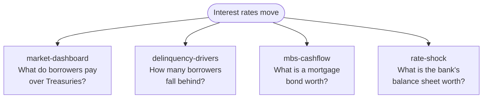
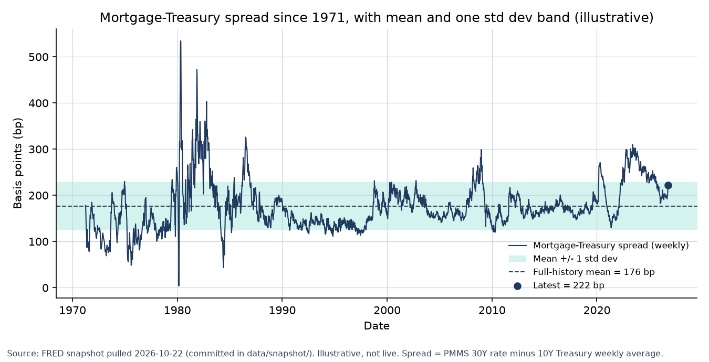
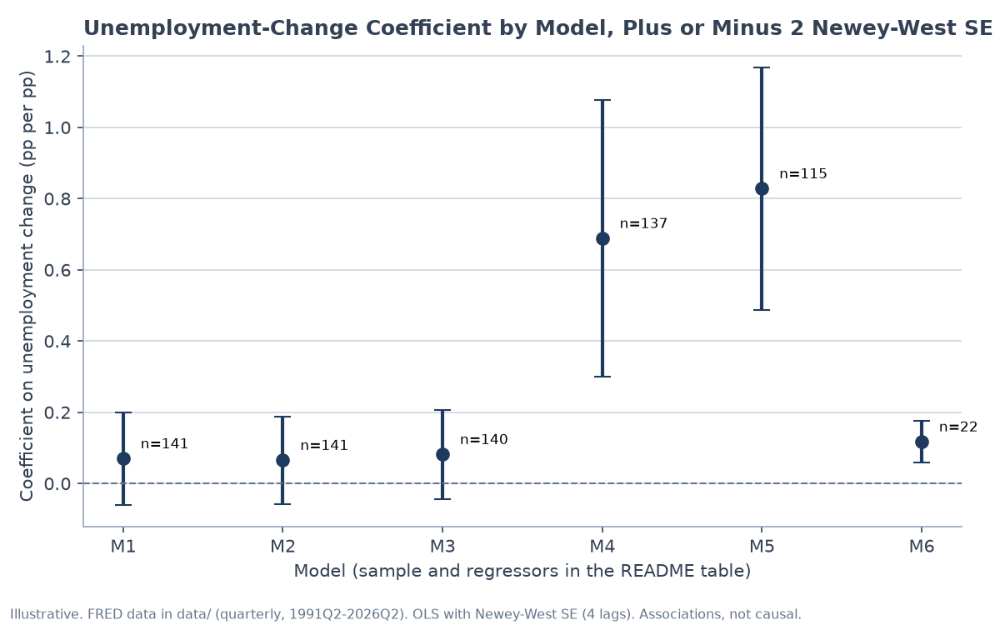
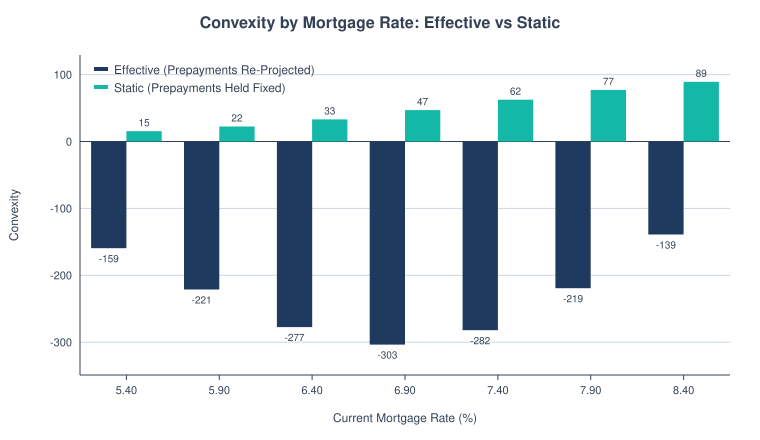
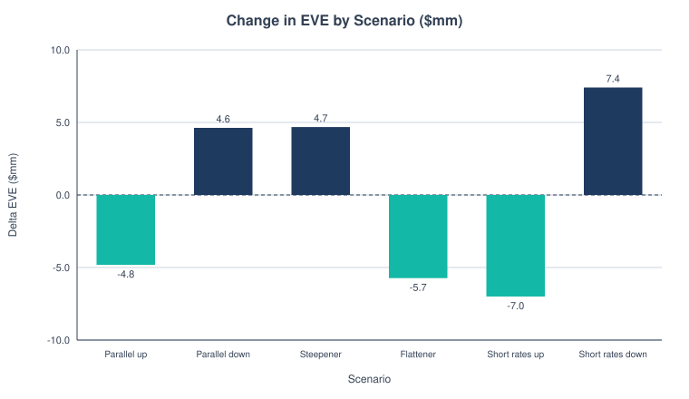

# Rates & Mortgage Risk Lab

When rates move, a bank feels it in four places: what borrowers pay for a mortgage, how many fall behind, what its mortgage bonds are worth, and what its balance sheet is worth. This repo models each one in Python, using public Federal Reserve (FRED) data where it exists.

Two results up front. On real data, mortgage rates sat **222 bp** above the 10-year Treasury on 15 Oct 2026, wider than 85% of weeks since 1971. And on a sample mortgage bond, convexity flips from **+62 to −282** once homeowners are allowed to refinance.



## What it shows

| Piece | Question | One result (from each worked example) |
|---|---|---|
| [market-dashboard](market-dashboard/) | Are mortgage rates wide or tight vs Treasuries? | Spread of **222 bp** on 15 Oct 2026, 85th percentile since 1971 (real FRED data) |
| [delinquency-drivers](delinquency-drivers/) | How much do job losses push up delinquency? | A 1-point unemployment jump adds about **0.7 points** of delinquency in a quarter (real FRED data, 1991 to 2026, leaving out 2020) |
| [mbs-cashflow](mbs-cashflow/) | What is a mortgage bond worth when homeowners can refinance? | Effective convexity of **−282** vs +62 static: prepayments flip the sign (illustrative pool) |
| [rate-shock](rate-shock/) | How much does a bond book lose on a rate move? | Duration alone overstates a +100 bp loss by **4.8%**; adding convexity cuts the error to 0.16% (illustrative bond) |

A few terms the table uses:

- **bp (basis point):** 0.01%. So 222 bp is 2.22 percentage points.
- **Spread:** the gap between two rates. Here, the mortgage rate minus the Treasury yield.
- **Delinquency:** the share of mortgages with late payments.
- **Duration:** the percent a bond's price falls when rates rise 1 point.
- **Convexity:** how that sensitivity changes as rates move. Normal bonds have positive convexity. Mortgage bonds go negative because homeowners refinance when rates fall, which caps the upside.
- **EVE and NII:** economic value of equity (the present value of a bank's assets minus its liabilities) and net interest income (what it earns on loans minus what it pays on deposits).

## The four pieces in pictures

**1. The mortgage-Treasury spread against its own history** ([market-dashboard](market-dashboard/))



**2. How strong the unemployment link is depends on the sample** ([delinquency-drivers](delinquency-drivers/))



**3. Prepayments turn convexity negative** ([mbs-cashflow](mbs-cashflow/))

<picture>
  <source media="(prefers-color-scheme: dark)" srcset="mbs-cashflow/docs/convexity_bars-dark.svg">
  
</picture>

**4. A sample bank under the six Basel rate shocks** ([rate-shock](rate-shock/))

<picture>
  <source media="(prefers-color-scheme: dark)" srcset="rate-shock/docs/eve_by_scenario-dark.svg">
  
</picture>

## Run it

Python 3.9+. The models use only the standard library. The SVG charts are drawn with it too. matplotlib is needed only for the PNG charts.

```bash
git clone https://github.com/builtby-hari/RatesMortgageRiskLab.git
cd RatesMortgageRiskLab
python3 run_tests.py                       # every test suite, all four pieces
cd mbs-cashflow && python3 cli.py --market-rate 7.40 --yield 5.5 --oas
```

Each folder has its own short README with a one-command demo, and a `docs/reference.md` with the full formulas and methods.

## Honest limits

- The MBS prepayment curve and OAS volatility are illustrative. They are not yet calibrated to agency prepayment data.
- The delinquency model leaves out 2020, so it describes ordinary quarters, not a pandemic shock. With 2020 left in, its R² (the share of the movement it explains) drops to about 0.05. Its README shows both.
- The four pieces run on their own today. Next step: one `scenario.toml` that feeds the dashboard's mortgage rate into the MBS prepayment model, and the delinquency path into the MBS default rate.

## How the repo was put together

Each folder was its own repo before. They were merged into this one repo so the four models live and get tested together.
