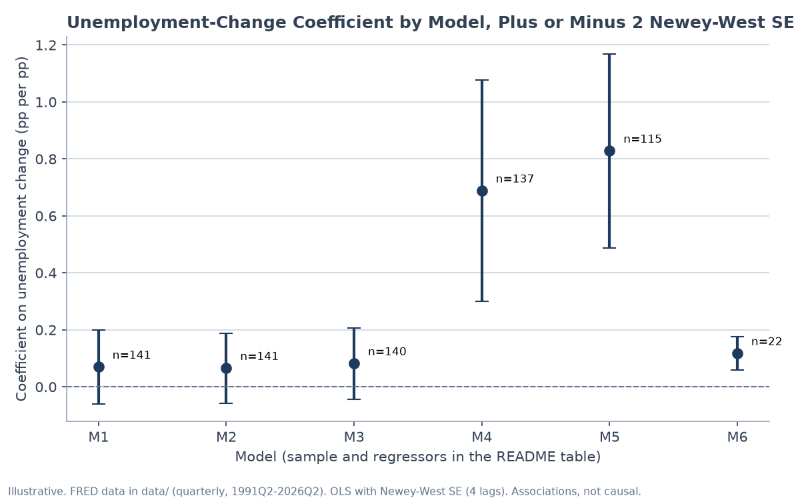
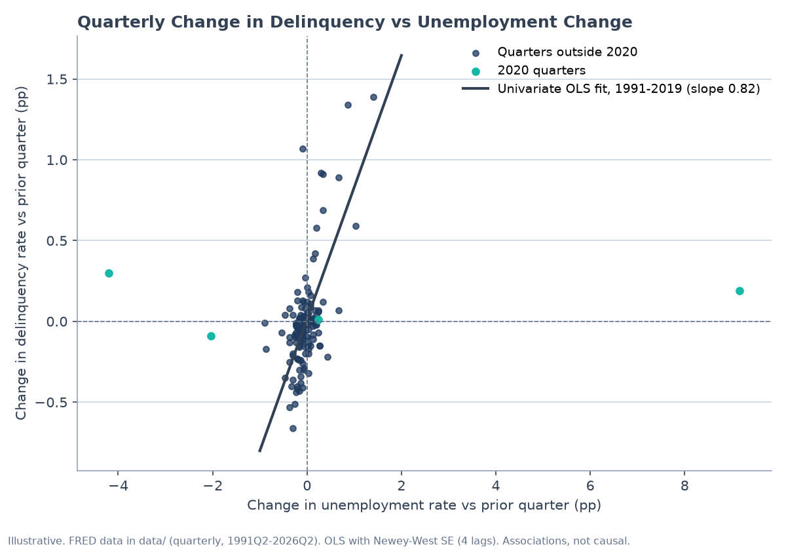
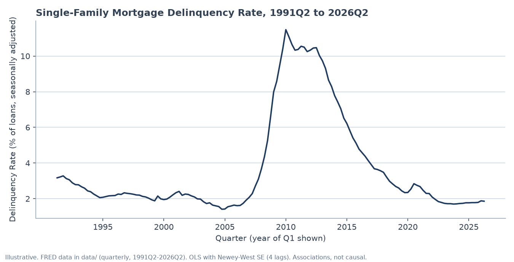
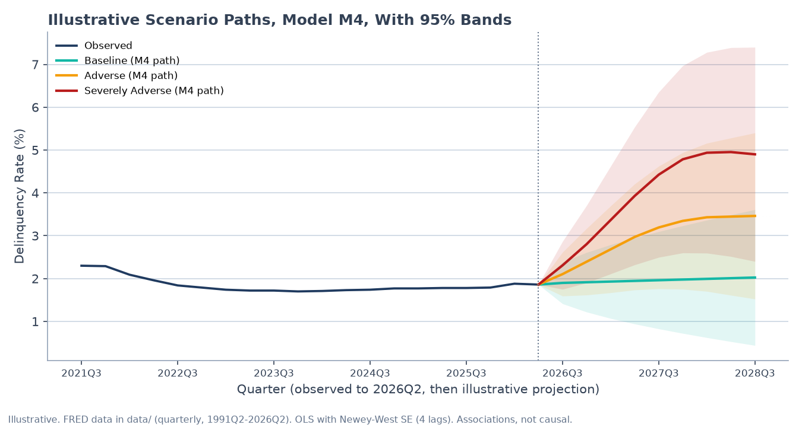
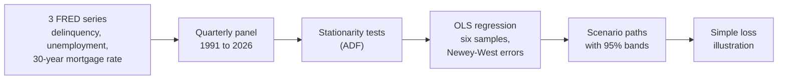

# Mortgage Delinquency Drivers

When people lose jobs, how many more fall behind on the mortgage? This takes 35 years of public Federal Reserve (FRED) data, fits a regression of the delinquency rate (the share of mortgages with late payments) on unemployment and mortgage rates, and projects delinquency under stress scenarios.

The answer depends on which years you include. Outside the pandemic, a 1-point rise in unemployment goes with about **0.7 points** more delinquency in the same quarter. With 2020 left in, the link nearly disappears.



## The result

- Leaving out 2020, each 1-point rise in unemployment goes with about **+0.69 points** of delinquency in the same quarter (t ≈ 3.5, so well clear of noise). Mortgage-rate changes add little there.
- The effect depends on the period: 0.83 before 2020, but only 0.12 in the short 2021 to 2026 sample (22 quarters), where mortgage rates start to matter. All six samples are shown instead of only the best one.
- Scenario: if unemployment jumps 1 point from the 2026Q2 level, delinquency goes from **1.86% to about 2.56%** in one quarter (95% band 1.92% to 3.21%).
- The fit depends on the sample. With 2020 included, R² (the share of the movement the model explains) is only 0.04 to 0.06, because the pandemic quarters swamp everything. Without 2020 it rises to 0.39. Both are reported.

Why 2020 breaks it: unemployment jumped about 9 points in one quarter and delinquency barely moved. Those are the teal dots far from the line:



The series itself. The 2010 peak is about 11.5%:



Three made-up stress paths run through the model, with 95% bands:



## Run it

```bash
python3 analysis.py                                         # fit the six models
python3 analysis.py --scenario scenarios/illustrative.csv   # project a scenario
python3 -m unittest discover                                 # tests
```

`python3 make_figures.py` re-prints the worked example and rebuilds the charts (needs matplotlib).

## How it works



- **Stationarity test (ADF):** checks that a series doesn't just drift, since regressions on drifting series find fake relationships. That's why the model uses quarter-to-quarter changes.
- **OLS:** ordinary least squares, the standard straight-line fit.
- **Newey-West errors:** standard errors that allow for one quarter's miss carrying into the next, which is normal for economic data. Without them the results look more certain than they are.
- **Six models:** unemployment only, plus the mortgage rate, plus one-quarter lags, then the same model without 2020, before 2020, and from 2021 on.

## What I fixed along the way

- Switched the ADF test to MacKinnon (2010) critical values, which adjust for sample size instead of assuming an infinitely long series.
- Durbin-Watson and the Newey-West lags now pair only quarters that are actually consecutive, so dropped quarters don't fake an autocorrelation.
- The loss figure is labelled a teaching placeholder, not a CECL model.

Full concepts, formulas and methods: [docs/reference.md](docs/reference.md).
