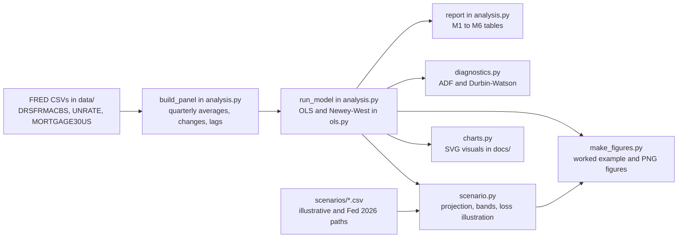
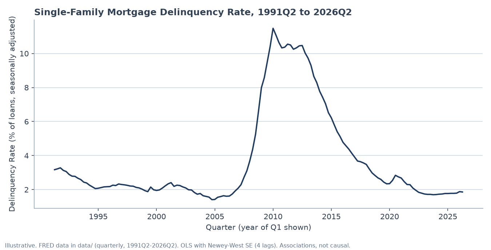
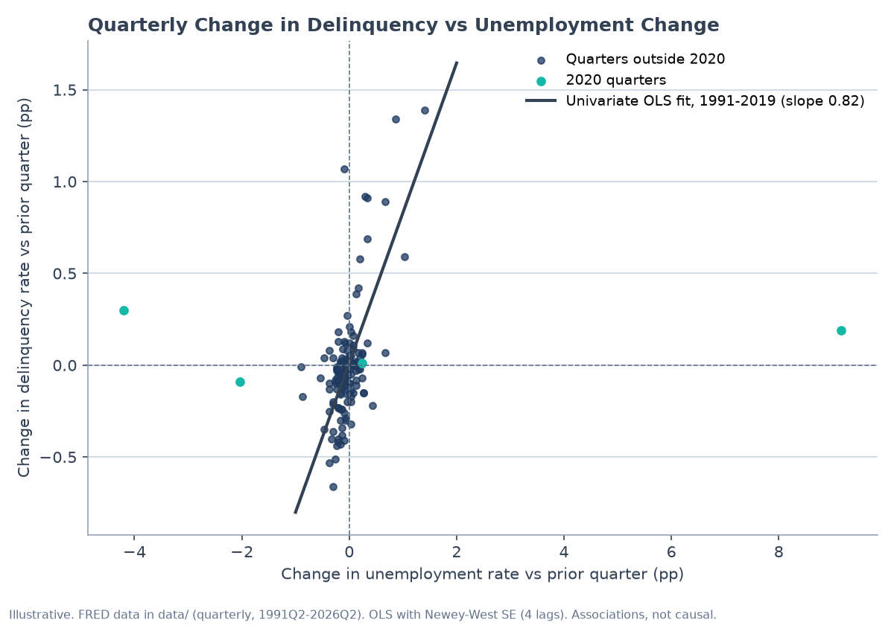
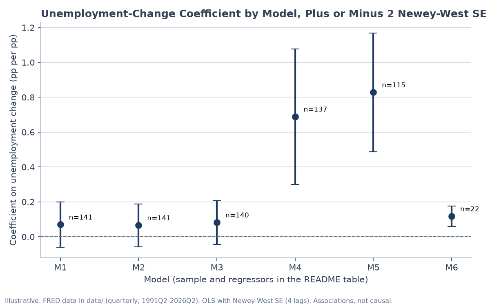
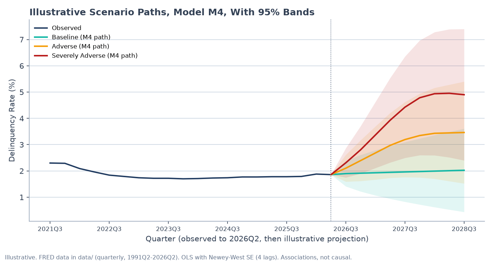

# Mortgage Delinquency Drivers: full reference

The short project overview is in the [README](../README.md). This page keeps the full detail: concepts and formulas, architecture, the worked example, methodology and validation.

## 1. Executive Summary

Do unemployment and mortgage rates explain quarterly changes in the U.S. single-family mortgage delinquency rate? This project builds a quarterly panel from public FRED data (1991Q2 to 2026Q2), fits ordinary least squares (OLS) models with Newey-West standard errors, and tests how the answer changes with the sample window. In plain terms: before 2020, a 1 percentage point jump in unemployment went with about a 0.8 percentage point jump in the delinquency rate in the same quarter, but the relationship is weak once the 2020 pandemic quarters are included, and mortgage rate changes add little. The code is pure Python (standard library only), with a scenario tool that projects delinquency under stylized unemployment and rate paths. All results are associations from a teaching-scale model, not causal estimates and not a forecast.

## 2. Key Concepts

**Delinquency rate.** The share of single-family mortgage loans held by U.S. commercial banks that are past due. The series is FRED `DRSFRMACBS`, seasonally adjusted, in percent. The model works with its quarter-over-quarter change, in percentage points (pp):

$$\Delta y_t = y_t - y_{t-1}$$

**OLS (ordinary least squares).** The straight-line fit that makes the sum of squared misses as small as possible. Coefficients show how much the outcome moves per one-unit move in an input, holding the other inputs fixed:

$$\hat\beta = (X^\top X)^{-1} X^\top y$$

**Newey-West standard errors (HAC).** Quarterly errors are not independent: a surprise this quarter tends to carry into the next. Ordinary standard errors would be too small. Newey-West (heteroskedasticity- and autocorrelation-consistent, "HAC") standard errors add up the error autocorrelations over 4 lags, with weights that shrink with the lag (Bartlett weights, $w_\ell = 1 - \ell/5$):

$$\widehat{\mathrm{Var}}(\hat\beta) = (X^\top X)^{-1}\, \hat S\, (X^\top X)^{-1}, \qquad \hat S = \sum_t s_t s_t^\top + \sum_{\ell=1}^{4} w_\ell \sum_t \left(s_t s_{t-\ell}^\top + s_{t-\ell} s_t^\top\right)$$

where $s_t = x_t e_t$ is each observation's regressor times its residual. Lag products only pair quarters that are exactly $\ell$ quarters apart, so gaps left by dropped quarters are not bridged.

**t-statistic.** A coefficient divided by its standard error, so a larger absolute value means the estimate is further from zero relative to its noise. Bold in the tables below means $|t| > 3$.

$$t_j = \hat\beta_j / \mathrm{SE}(\hat\beta_j)$$

**R-squared.** The share of the quarter-to-quarter ups and downs in the outcome that the model explains, from 0 (none) to 1 (all). A low value here means most quarter-to-quarter noise is unexplained:

$$R^2 = 1 - \frac{\sum_t e_t^2}{\sum_t (y_t - \bar y)^2}$$

**Augmented Dickey-Fuller (ADF) test.** Checks whether a series wanders without a fixed mean (a unit root). A rejection means the series is stationary, which OLS needs for ordinary inference. The test regresses the change in the series on its lagged level and 4 lagged changes; critical values come from MacKinnon (2010) finite-sample formulas.

$$\Delta y_t = a + \gamma\, y_{t-1} + \sum_{i=1}^{4} \delta_i \Delta y_{t-i} + e_t, \qquad \text{statistic} = \hat\gamma / \mathrm{SE}(\hat\gamma)$$

**Durbin-Watson statistic.** Near 2 means no first-order autocorrelation in the residuals. Values well below 2 mean residuals carry over from one quarter to the next, which is why the Newey-West errors matter here.

$$DW = \frac{\sum_t (e_t - e_{t-1})^2}{\sum_t e_t^2}$$

**Scenario projection.** Each projected quarter's change in delinquency is the model's prediction from the change in the scenario paths. The changes are summed onto the last observed rate. Bands come from the coefficient covariance plus residual noise: $\mathrm{Var} = c^\top V c + h\hat\sigma^2$, where $c$ is the sum of the regressor vectors over $h$ quarters and $V$ is the Newey-West coefficient covariance.

**Loss rate (teaching placeholder).** Each quarter, a share of the delinquent balance rolls to default (20% by default), and a share of that is lost (25% loss given default). This is not a CECL model (no lifetime horizon, cures, recoveries or discounting). Cumulative loss is summed over the $H = 9$ projected quarters:

$$L = \sum_{t=1}^{H} \ell_t \times \text{roll rate} \times \text{LGD}$$

where $\ell_t$ is the projected delinquency rate in quarter $t$, in percent of balance.

## 3. Architecture



## 4. Worked Example (Illustrative)

**Question.** Suppose unemployment jumps 1 percentage point in one quarter from the 2026Q2 level, and the mortgage rate does not move. What does model M4 (M2 without the four 2020 quarters, n = 137) say delinquency does one quarter later?

**Inputs.**

| Input | Value | Source |
|---|---:|---|
| Delinquency, 2026Q2 (last observed) | 1.86% | `DRSFRMACBS` |
| Unemployment, 2026Q2 quarterly average | 4.27% | `UNRATE` |
| 30-year mortgage rate, 2026Q2 average | 6.41% | `MORTGAGE30US` |
| Shock: change in unemployment, $\Delta u$ | +1.00 pp | Hypothetical |
| Shock: change in mortgage rate, $\Delta r$ | 0.00 pp | Hypothetical |

**Coefficients (M4).** Constant 0.0157 (SE 0.0375); unemployment change 0.6882 (SE 0.1944); mortgage rate change 0.0081 (SE 0.0391). Residual variance $\hat\sigma^2 = 0.0598$. Coefficient covariance $V$ from Newey-West.

**Steps.**

1. Predicted change: $\hat\beta^\top x = 0.0157 + 0.6882 \times 1.00 + 0.0081 \times 0.00 = 0.7039$ pp.
2. Level after one quarter: $1.86 + 0.7039 = 2.56\%$.
3. Variance: $x^\top V x + \hat\sigma^2 = 0.0478 + 0.0598 = 0.1075$, so the standard error is $\sqrt{0.1075} = 0.328$ pp.
4. 95% band: $2.56 \pm 1.96 \times 0.328 = 1.92$ to $3.21\%$.
5. Teaching loss for that one quarter: $2.56\% \times 20\% \times 25\% = 0.128\%$, or $12.8 million on a $10,000 million illustrative portfolio.

**Output.** Delinquency rises to about 2.56% after one quarter (95% band 1.92% to 3.21%), with a loss illustration of about $12.8 million on the illustrative book.

**Interpretation.** In this model, a one-point unemployment jump goes with a rise of about 0.7 points in delinquency within the quarter, but the band is wide and the model excludes 2020, so the figure describes ordinary quarters, not a pandemic-style shock.

The script that reproduces these numbers is in Section 8.

## 5. Visuals

All four figures are written by `make_figures.py` into `docs/figures/`. Each one states its data and assumptions in the footer. Results are illustrative.

**Figure 1. Delinquency level.** The single-family delinquency rate from 1991Q2 to 2026Q2. Units: percent of loans. The 2010 peak is about 11.5%.



**Figure 2. Change against change.** Quarterly change in delinquency against quarterly change in unemployment, in percentage points. The line is a univariate OLS fit over 1991Q1 to 2019Q4 (slope 0.82). M5 in Section 6, which also includes the mortgage rate change, gives 0.83; the two differ only because of the rate term. The 2020 quarters (teal) sit far from the line.



**Figure 3. Coefficient across samples.** The unemployment-change coefficient in models M1 to M6, with bars spanning plus or minus 2 Newey-West standard errors. Units: pp of delinquency per pp of unemployment. The estimate moves from about 0.07 (full sample) to about 0.69 (ex-2020) and 0.83 (pre-2020). This sensitivity to the sample is the main result.



**Figure 4. Scenario paths.** Model M4 applied to the illustrative stylized paths in `scenarios/illustrative.csv`, with 95% bands. Units: percent. The bands are computed with the formula in Section 2 and are probably too narrow at long horizons (Section 6).



## 6. Methodology and Assumptions

**Data.** Three FRED series are pinned as CSV files in `data/` (no API key needed; `fetch_fred.py` refreshes them):

| FRED ID | Series | Frequency | Quarterly aggregation |
|---|---|---|---|
| `DRSFRMACBS` | Delinquency rate, single-family residential mortgages, domestic offices, all commercial banks, seasonally adjusted | Quarterly | Quarter-start value |
| `UNRATE` | Civilian unemployment rate | Monthly | Quarter average |
| `MORTGAGE30US` | 30-year fixed mortgage rate (Freddie Mac PMMS, via FRED) | Weekly | Quarter average |

The panel runs 1991Q2 to 2026Q2, giving 141 quarter-over-quarter changes. Only quarters present in all three series are used, and the code raises an error if any quarter is missing.

**Specifications.** The dependent variable is $\Delta y_t$ in pp. Regressors are changes in unemployment and the mortgage rate, plus one-quarter lags in M3.

| Model | Regressors | Sample | n | R² |
|---|---|---|---:|---:|
| M1 | Δ unemployment | 1991Q2-2026Q2 | 141 | 0.043 |
| M2 | Δ unemployment, Δ mortgage rate | 1991Q2-2026Q2 | 141 | 0.061 |
| M3 | M2 plus one-quarter lags | 1991Q2-2026Q2 | 140 | 0.144 |
| M4 | M2, excluding 2020Q1-2020Q4 | 1991Q2-2026Q2 | 137 | 0.389 |
| M5 | M2 | 1991Q2-2019Q4 | 115 | 0.450 |
| M6 | M2 | 2021Q1-2026Q2 | 22 | 0.366 |

| Term | M1 | M2 | M3 | M4 | M5 | M6 |
|---|---:|---:|---:|---:|---:|---:|
| Δ unemployment | 0.070 (1.07) | 0.065 (1.06) | 0.082 (1.30) | **0.688 (3.54)** | **0.828 (4.86)** | **0.117 (4.06)** |
| Δ mortgage rate | | −0.117 (−1.56) | −0.083 (−1.30) | 0.008 (0.21) | 0.040 (0.72) | **−0.057 (−3.58)** |
| Δ unemployment, lag 1 | | | 0.098 (1.68) | | | |
| Δ mortgage rate, lag 1 | | | −0.026 (−0.68) | | | |

Coefficients, with Newey-West t-statistics in parentheses.

**Standard errors and lags.** Newey-West with 4 lags and Bartlett weights for every model. The Newey-West (1994) rule of thumb gives 4 for n = 140 and 2 for n = 22 (M6). The model keeps 4 lags everywhere, so M6's standard errors are unreliable: its Durbin-Watson is 2.36 and its t-statistic grows with more lags. A lag check (run during review, not in the repo) shows the M2 unemployment t-statistic stays below 2 at 0, 4, 8 and 15 lags. In M4 it is 3.5 at 4 lags, 3.1 at 8 and 3.0 at 15, so it stays significant at 5% but sits near the |t| > 3 threshold at longer lags.

**Residual autocorrelation.** Durbin-Watson is 0.54 to 0.57 for M1 to M3, 0.93 for M4 and 1.05 for M5, so residuals are strongly positively autocorrelated. This is the reason for Newey-West errors.

**Stationarity.** ADF with a constant and 4 lags, MacKinnon (2010) critical values (about −2.88 at 5% for these sample sizes). At 5%, a unit root cannot be rejected for the delinquency level (stat −2.75) or its change (−2.63). It is rejected for the unemployment change (−5.47) and the mortgage-rate change (−5.29). A unit root in the outcome is a caveat for any level interpretation; the model uses changes.

**Scenario projection and bands.** Changes in the scenario paths map into predicted changes in delinquency, summed onto the last observed rate. The 95% band is $\pm 1.96$ times the square root of $c^\top V c + h\hat\sigma^2$. **Known weakness:** the code treats residual shocks as independent across quarters. Residuals are autocorrelated, so the long-run variance of the residual sum is larger than $h\hat\sigma^2$. A one-off check on the M4 residuals (approximate, bridging the 2020 gap) gives a long-run variance about 2.6 times $\hat\sigma^2$, so the noise part of the band is about 1.6 times too narrow at long horizons. The bands should be read as lower bounds on width. Fixing this is a planned change.

**Federal Reserve 2026 paths.** `scenarios/fed_2026.csv` holds the Fed's final 2026 supervisory baseline and severely adverse paths (unemployment and 30-year mortgage rate), copied by hand from Tables 3.A and 4.A on the Fed's stress-test page. The Fed's paths start in 2026Q1, so they do not match the observed 2026Q2 level. By default the published levels are used. With `--rebase`, each path is shifted so 2026Q2 equals the observed level, keeping the Fed's changes. Source details are in `scenarios/README.md`.

**Illustrative paths.** `scenarios/illustrative.csv` was written by the author as stylized paths. They are not the Fed's paths and not a forecast.

**Loss illustration.** Each quarter's delinquency level (a percent of balance) is multiplied by the roll rate and the LGD, then summed over 9 quarters. Two caveats. First, the roll rate and LGD are placeholders, not estimates. Second, the formula applies the rate to the stock of delinquent loans in every quarter, so the same loans can be counted more than once; it is a mechanical illustration, not a loss model. A stock-flow roll-rate model is the next step.

**Scope and assumptions.**
- Associations only. Unemployment, rates and delinquency respond to the same economic conditions.
- Bank-held single-family loans. Agency (government-sponsored enterprise) pools are not covered.
- Quarterly averages smooth within-quarter timing, so the lag structure is approximate.
- The 2020 exclusion (M4) is a judgment call, not a test.
- FRED series are revised, and the latest quarter is published with a lag.
- The NBER recession dates used for shading are hardcoded in `charts.py`.
- No small-sample correction is applied to the Newey-West covariance (a factor of n/(n−k), about 1% at n = 137 and about 8% at n = 22).

## 7. Validation

- **Hand-computed reference values.** The Newey-West covariance is checked against values computed by hand for a constant-only regression with one and two lags (Bartlett weights 1/2 and 2/3, 1/3). The gap-handling rule is tested by comparing a contiguous index with one that skips a period.
- **Independent cross-check with statsmodels 0.15.0.** For M2 and M3, the OLS coefficients, the Newey-West standard errors (HAC, 4 lags, no small-sample correction) and R² match statsmodels to six decimal places. For M4, the standard errors differ by about 0.2%. The difference comes entirely from gap handling: statsmodels pairs the rows on either side of the 2020 gap, while this code does not bridge the gap. Feeding this code the same bridged rows reproduces the statsmodels values exactly. The ADF statistic for the delinquency level matches `statsmodels.tsa.stattools.adfuller` (−2.7620 on the level series from 1991Q1; the −2.75 in Section 6 starts at 1991Q2).
- **Critical values.** The MacKinnon (2010) response-surface coefficients match the statsmodels tables cited in `diagnostics.py`.
- **Synthetic data.** Unit tests for OLS use random data with known coefficients to check recovery. The analysis itself runs only on the FRED series in `data/`.
- **Reproduction.** The README tables were regenerated from the code during review, and every number in Sections 4 to 6 was checked against command output.

Test command (standard library only; the statsmodels cross-check runs only if statsmodels is installed):

```bash
python3 -m unittest discover
```

## 8. Quick Start

Requires Python 3.9 or later. The core analysis needs no third-party packages. The figures need matplotlib.

```bash
pip install -r requirements-extra.txt
python3 make_figures.py
```

This prints the worked example in Section 4 and writes the four PNG figures in `docs/figures/`. Other entry points: `python3 analysis.py` (the six models), `python3 analysis.py --scenario scenarios/illustrative.csv` (scenario projection), and `python3 charts.py` (the SVG visuals in `docs/`).
