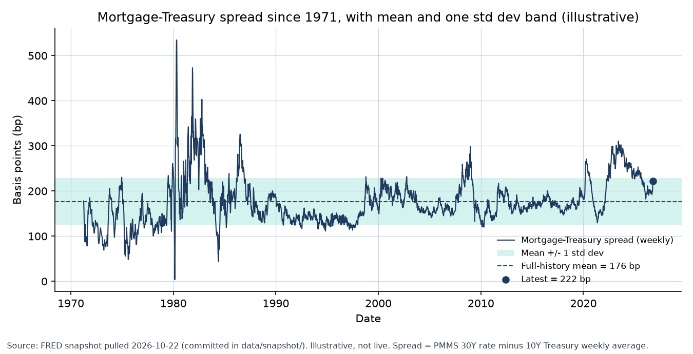
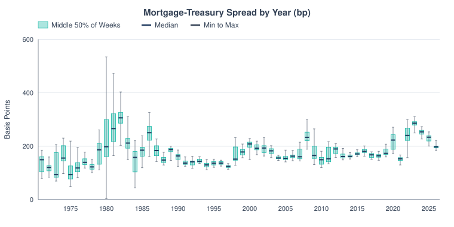
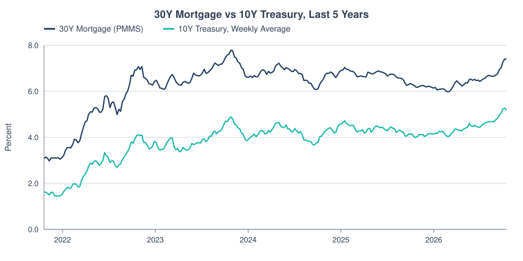
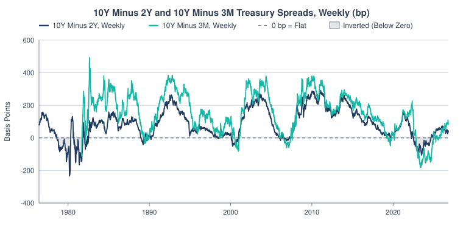
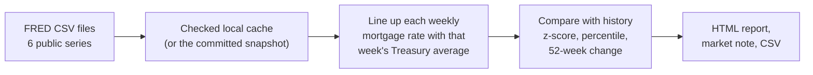

# Mortgage Market Dashboard

A weekly desk check: how far is the 30-year mortgage rate above the 10-year Treasury yield, and is that gap wide or tight compared with history? It pulls six public Federal Reserve (FRED) series and writes an HTML report and a short market note.

Latest reading in the committed data (15 Oct 2026): the gap is **222 bp**, wider than 85% of weeks since 1971. (A basis point, bp, is 0.01%, so 222 bp is 2.22 percentage points.)



## The result (15 Oct 2026, real FRED data)

- Mortgage rate **7.40%**, 10-year Treasury weekly average **5.19%**, so the spread is **222 bp**.
- That is **0.9 standard deviations** above the 1971 to 2026 average, the **85th percentile** of 2,899 weeks.
- Against the last five years it is **below** average (z = −0.46), so the spread is not stretched on a recent view.
- The 10Y−2Y curve is **+33 bp**. It has been inverted on 16% of trading days since 1976.

The same spread year by year. Each box is the middle half of that year's weeks and the whiskers are the low and high:

<picture>
  <source media="(prefers-color-scheme: dark)" srcset="docs/spread-by-year-dark.svg">
  
</picture>

The two rates behind the spread, over the last five years:

<picture>
  <source media="(prefers-color-scheme: dark)" srcset="docs/rates-dark.svg">
  
</picture>

And the shape of the Treasury curve. Long rates are normally above short rates. When that flips, the curve is inverted:

<picture>
  <source media="(prefers-color-scheme: dark)" srcset="docs/curve-dark.svg">
  
</picture>

## Run it

```bash
python3 cli.py --offline          # report from the committed data snapshot, no network needed
python3 cli.py                    # refresh from FRED first
python3 -m unittest discover      # tests
```

Output goes to `out/report.html` and `out/aligned.csv`. `python3 scripts/reproduce.py` re-prints the worked example and rebuilds the charts (needs matplotlib).

`python3 charts.py` redraws the SVG charts with no installs.

## How it works



The mortgage survey comes out once a week and Treasury yields come out daily, so each weekly mortgage rate is matched with the average Treasury yield for the same week. The z-score is how many standard deviations today's spread sits from its long-run average. A committed snapshot lets it all run offline.

## What I fixed along the way

- The market note once claimed a primary-secondary mortgage spread the tool can't measure. It now only states what the data supports.
- FRED sometimes serves an HTML maintenance page instead of CSV. The loader now says so clearly instead of failing on a missing header.
- If one leg of the curve is stale, the report warns instead of quietly mixing dates.

Full concepts, formulas and methods: [docs/reference.md](docs/reference.md).
