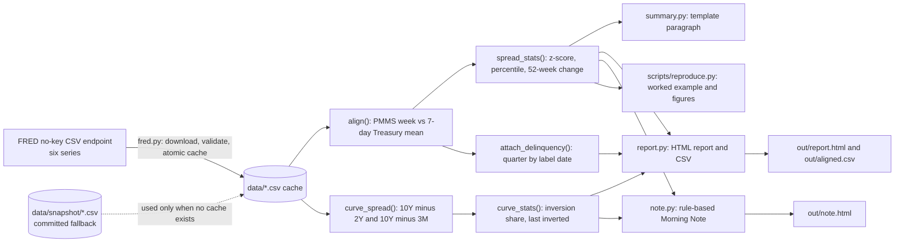
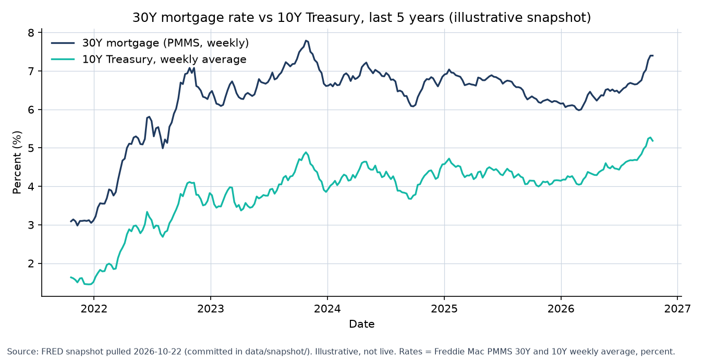
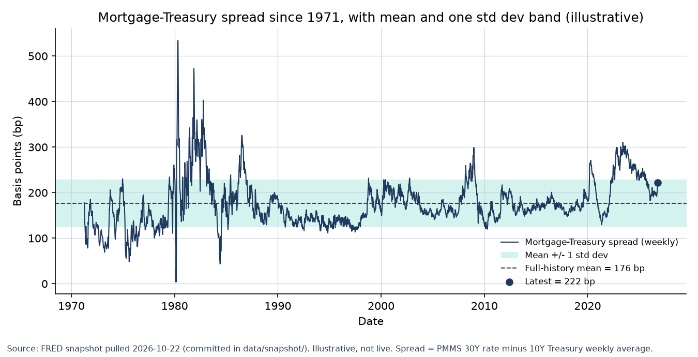
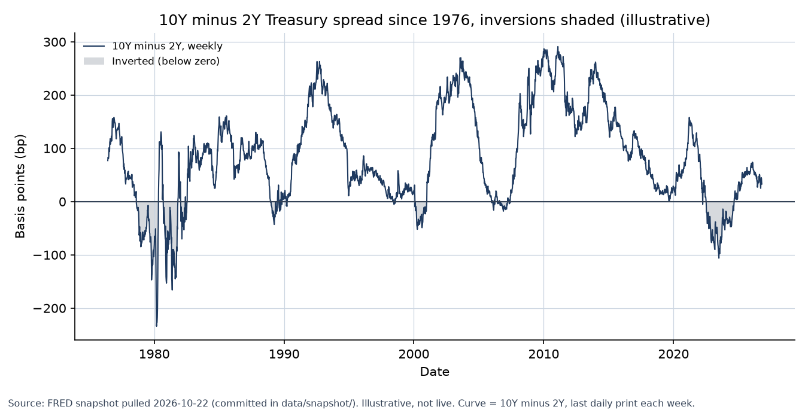

# Mortgage Market Dashboard: full reference

The short project overview is in the [README](../README.md). This page keeps the full detail: concepts and formulas, architecture, the worked example, methodology and validation.

## 1. Executive Summary

This is a small Python tool that answers one desk question each week: how far are 30-year mortgage rates sitting above the 10-year Treasury yield, and is that gap wide or tight compared with history? It pulls six public series from the Federal Reserve Bank of St. Louis (FRED), lines up each weekly Freddie Mac mortgage rate with the average 10-year Treasury yield for the same week, and measures the gap (the "spread"). It then places that gap against its own history, adds the Treasury yield curve and bank mortgage delinquency as context, and writes an HTML report, a CSV, and a one-page Morning Note. The core uses only the Python standard library, needs no API key, and runs offline from a committed data snapshot. All numbers in this README are **illustrative**, computed from that snapshot, not live market data.

## 2. Key Concepts

**Mortgage-Treasury spread.** The mortgage rate minus the Treasury yield, the markup borrowers pay over the risk-free benchmark. Mortgages are priced as a spread to Treasuries, so the spread shows whether mortgage pricing is cheap or rich against rates. Here the mortgage rate is the Freddie Mac Primary Mortgage Market Survey (PMMS), an average of quoted 30-year fixed rates. The Treasury leg is the 10-year constant-maturity yield, averaged over the same week.

$$S(d) = M_{30}(d) - T(d), \qquad T(d) = \frac{1}{n_d}\sum_{t \in [d-6,\, d]} \mathrm{DGS10}_t$$

**Z-score.** How many standard deviations today's spread sits above or below its average. Standard deviation is a typical distance from the average; a z of +1 means one "typical" step above normal. This is descriptive, not a trading signal: spreads drift between regimes, so the tool also reports a 5-year version.

$$z = \frac{S_{\text{now}} - \bar{S}}{s_S}$$

**Percentile.** Where today's spread ranks among all past readings. The tool uses the mid-rank convention, which counts ties as half below.

$$p = \frac{\#\{S_i < S\} + \tfrac{1}{2}\,\#\{S_i = S\}}{N} \times 100$$

**Yield curve slope and inversion.** The 10-year minus the 2-year Treasury yield. When it drops below zero the curve is "inverted": short-term yields are above long-term ones, which has historically been an uncommon state and a common backdrop before recessions. The tool counts how often it has been inverted but does not forecast anything from that count.

$$\mathrm{Curve}(d) = 10Y(d) - 2Y(d)$$

**Yield volatility.** How much the 10-year yield moves day to day, measured as the sample standard deviation of daily changes over the last 63 calendar days, in basis points (bp; 1 bp = 0.01 percentage point). The tool reports this raw, not annualized. Annualizing by the square root of 252 trading days would give about 79 bp a year for the 5.0 bp daily figure below.

**Delinquency rate.** The share of single-family mortgage loans at US commercial banks that are past due. It is quarterly, so the tool compares the latest quarter with the one four quarters earlier to judge the trend.

$$\Delta_{4Q} = D(q) - D(q-4)$$

## 3. Architecture

The data flows from FRED through a cache, into alignment and statistics, and out to the report, the note, and the figures. The dashed line is the offline fallback.



## 4. Worked Example

The example is the latest PMMS week in the committed snapshot (Thursday, October 15, 2026). The inputs are real snapshot values; the outputs are illustrative. The Columbus Day holiday on October 12 has no Treasury print, so the weekly average uses four prints, not seven.

| Input | Value |
|---|---|
| PMMS 30-year fixed rate, Thu Oct 15, 2026 | 7.40% |
| DGS10 prints, Fri Oct 9 / Tue Oct 13 / Wed Oct 14 / Thu Oct 15 | 5.24% / 5.21% / 5.19% / 5.10% |
| Oct 12 (holiday, no print) | excluded |
| Full-history spread stats (1971 to 2026, 2,899 weeks) | mean 176.3 bp, sd 52.0 bp |

| Step | Calculation | Result |
|---|---|---|
| 1. Treasury weekly average | (5.24 + 5.21 + 5.19 + 5.10) / 4 | 5.1850% |
| 2. Spread | 7.40 - 5.1850 | 221.5 bp (printed as 222 bp) |
| 3. Z-score | (221.5 - 176.3) / 52.0 | +0.87 (printed as +0.9) |
| 4. Percentile | mid-rank over 2,899 weeks | 84.6th (printed as 85th) |
| 5. Five-year z-score | against the trailing five years | -0.46 (30.5th percentile) |
| 6. 30Y rate change | 52-week change | +113 bp; unchanged on the week |
| 7. 10Y minus 2Y | Oct 20, 2026 print | +33 bp; inverted on 16% of 12,593 daily readings since 1976 |

**Output:** the mortgage-Treasury spread was 222 bp, 0.9 standard deviations above its full-history average, and in the 85th percentile of the full history.

**Interpretation (illustrative):** mortgages sat about 2.2 points over the 10-year, wider than the 1971-onward average, yet slightly below the trailing five-year average. On the five-year view, the spread is not stretched.

Reproduce this exact output with the command in section 8.

## 5. Visuals

All three figures are drawn from the committed snapshot by `scripts/reproduce.py`. Each has labeled axes with units, a title, and a source and assumptions footer. They are illustrative, not live.



*Figure 1. 30-year PMMS mortgage rate (percent) against the 10-year Treasury weekly average (percent), last five years. Assumption: the Treasury leg is the mean of the daily prints in the seven days ending on the PMMS date.*



*Figure 2. Weekly mortgage-Treasury spread (bp) since 1971. The shaded band is the full-history mean plus or minus one standard deviation; the dot is the latest week (222 bp). Assumption: the full history mixes regimes, so the 5-year view in section 4 is the fairer comparison.*



*Figure 3. 10-year minus 2-year Treasury spread (bp), weekly, since 1976. Shaded where the curve is inverted (below zero). Assumption: a descriptive count, not a recession forecast.*

## 6. Methodology and Assumptions

- **Alignment.** Each PMMS observation on date `d` is paired with the mean of all DGS10 prints dated `d-6` through `d`. Holidays and missing prints drop out. Weeks with no Treasury print are skipped.
- **Statistics.** Z-scores use the sample standard deviation over the stated history, with the current week included. Percentiles use the mid-rank convention. The 5-year z-score is always the trailing five years, regardless of the `--window-years` setting.
- **Curve.** The 10Y-2Y and 10Y-3M slopes are an inner join on date: if one leg is missing that day, the day is dropped rather than filled.
- **Delinquency.** Quarterly bank data (FRED `DRSFRMACBS`, commercial banks, not agency pools). The trend is "rising" or "falling" when the 4-quarter change exceeds 0.10 percentage points.
- **Data.** Six public FRED CSV series with no key. Downloads are validated before the cache is replaced (writes are atomic). If a download fails, the tool falls back to the cache, then to the committed snapshot in `data/snapshot/`. It never fabricates values.
- **Note rules.** The Morning Note text is produced by fixed rules and thresholds (for example, a 25 bp 52-week move or a 1 standard deviation spread move). The Read Across lines are conditional statements, not forecasts.

**Known limitations and assumptions** (stated so a reviewer does not have to find them):

- The PMMS survey covers Monday to Wednesday and is released on Thursday. The Treasury window runs Friday to Thursday, a simplification.
- The spread is PMMS minus the 10-year yield. It is **not** an option-adjusted spread (OAS) and not a current-coupon MBS spread. It mixes the primary-secondary spread, the MBS spread, and the gap between the 10-year and the average mortgage life.
- The full-history z-score spans very different regimes. Spread changes are autocorrelated and not normal, so the z-score is descriptive only.
- **Look-ahead in the CSV.** Delinquency is attached to each weekly row by its quarter label date, not its publication date, which comes months later. The `delinquency` column in `aligned.csv` is therefore not point-in-time. The HTML report does not use that column for any statistic.
- **Weekly change.** The "on the week" change uses the latest print at or before seven days earlier, with no tolerance. On 87 holiday-shifted weeks no such print exists, so the weekly change is left blank. Tracked as a GitHub issue; the definition has not been changed here.
- **Provenance.** The HTML report, CSV and note do not say whether their data came from a live download, the cache, or the committed snapshot. Check the "Data through" date and the stale-data warning.
- No revisions handling: FRED data are used as last published, and cached files are not versioned.
- Informational only. Not investment advice.

## 7. Validation

- **Hand arithmetic.** The worked example in section 4 was recomputed by hand from the printed inputs. It matches the program output: a 5.1850% Treasury average, 221.5 bp spread, +0.87 z-score, and 84.6 mid-rank percentile.
- **Snapshot reproduction.** `python3 cli.py --offline` reproduces the same headline numbers, including the 1971 history count of 2,899 weeks and the 10Y-2Y value of +33 bp.
- **Unit tests.** Test cases use committed fixtures and known values: z-score and percentile on small hand-checkable inputs, `change_over_days` boundaries, the holiday gap in the weekly average, the curve inner join, inversion dates, the 10-year volatility on a hand-computed alternating series, and the CLI's error and stale-data paths. No network is used.
- **Figures.** The three PNGs were opened and checked for labels, units, and the footer. The Mermaid diagram was parsed with the mermaid parser (version 11) and passed; a deliberately broken diagram failed, so the check is not a no-op.
- **References.** Series definitions follow FRED's documentation (`MORTGAGE30US`, `DGS10`, `DGS2`, `DGS3MO`, `DRSFRMACBS`) and the Freddie Mac PMMS methodology. Spread and OAS concepts follow Fabozzi's fixed-income and mortgage-backed securities texts; chapter-level citations were not checked in this pass.

Test command (no network):

```bash
python3 -m unittest discover -v
```

## 8. Quick Start

Requirements: Python 3 for the core tool (tested on Python 3.13 only; 3.9 is not yet verified). Figures need matplotlib.

```bash
git clone https://github.com/builtby-hari/RatesMortgageRiskLab.git && cd RatesMortgageRiskLab/market-dashboard
python3 -m venv .venv && . .venv/bin/activate && pip install -r requirements-extra.txt
python3 scripts/reproduce.py
```

That one command prints the worked example in section 4 and regenerates `docs/figures/*.png`. It reads only the committed snapshot, so it works offline.

The core dashboard needs no install: `python3 cli.py --offline` writes `out/report.html`, `out/aligned.csv`, and the market summary to the terminal. Add `--note out/note.html` for the Morning Note.
