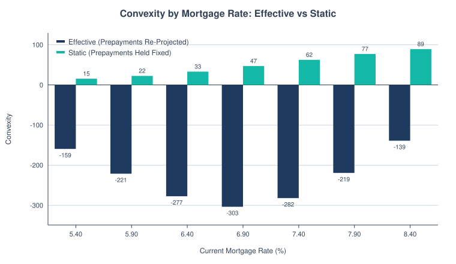
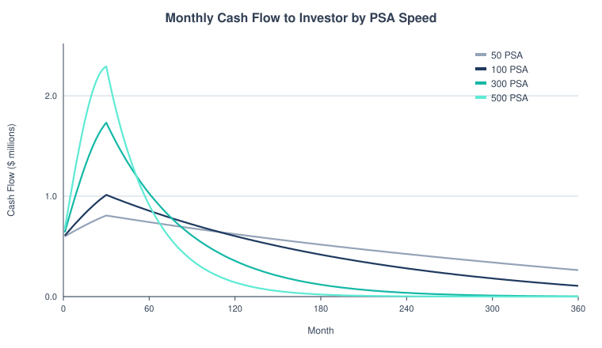
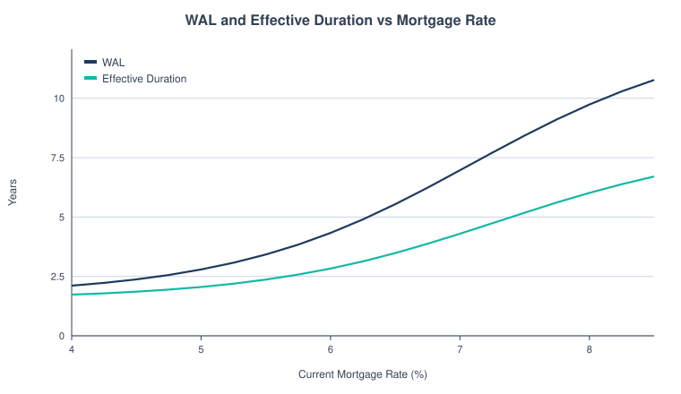
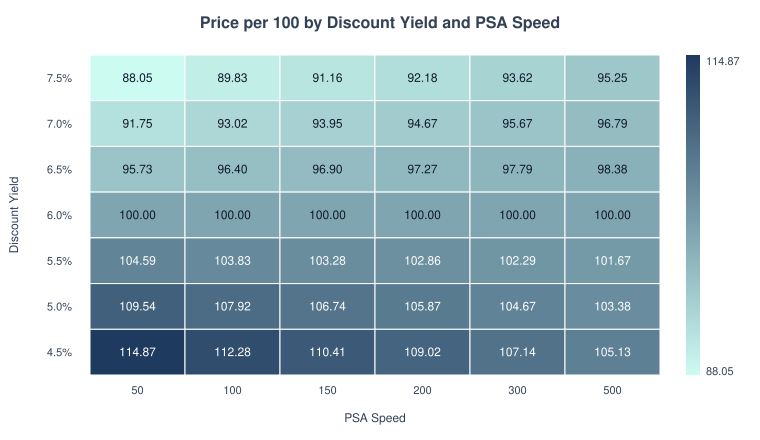
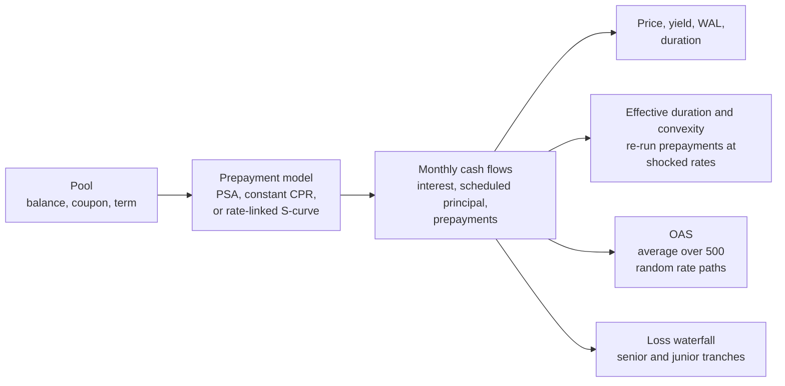

# MBS Cash Flow Model

A mortgage bond doesn't have a fixed maturity. Homeowners refinance when rates fall, so the bond pays back early exactly when the investor wants it to keep paying. This model projects the monthly cash flows of a mortgage pass-through (a bond that passes homeowners' payments straight to investors), prices it, and measures what that refinancing option costs.

On the sample pool, convexity goes from **+62 to −282** once prepayments are allowed to react to rates, and the refinancing option costs the investor about **76 bp** of yield a year.

<picture>
  <source media="(prefers-color-scheme: dark)" srcset="docs/convexity_bars-dark.svg">
  
</picture>

## The terms

- **Prepayment:** a homeowner paying the loan off early, usually by refinancing or moving.
- **PSA:** the standard prepayment speed scale. 100 PSA ramps up to 6% of the pool prepaying per year after 30 months, and 200 PSA is twice that.
- **CPR:** the share of the pool that prepays in a year.
- **Duration:** how much the price falls, in percent, when rates rise 1 point.
- **Convexity:** how duration itself changes as rates move. Positive is good for the holder. Negative means the bond gains less when rates fall and loses more when they rise.
- **Static vs effective:** static holds the cash flows fixed. Effective re-runs prepayments at the new rate, which is what actually happens.
- **WAL:** weighted average life, the average time until each dollar of principal comes back.
- **OAS (option-adjusted spread):** the yield spread left over after taking out the value of the homeowner's refinancing option. Z-spread is the spread before taking it out.

## The result (illustrative $100mm pool, 6.0% coupon)

| Measure | Value | What it means |
|---|---|---|
| Price | 102.905 | Premium bond, discounted at 5.50% |
| Static vs effective duration | 5.80 vs **5.01** | Re-projecting prepayments shortens it |
| Static vs effective convexity | +62.4 vs **−282.1** | Prepayments flip the sign: negative convexity |
| Z-spread / OAS / option cost | 71.9 / −3.8 / **75.6 bp** | Most of the spread pays for the borrower's refinancing option |

Faster prepayments pull the cash forward and end the bond sooner:

<picture>
  <source media="(prefers-color-scheme: dark)" srcset="docs/cashflow_profile_by_psa-dark.svg">
  
</picture>

So the bond's life shrinks when rates fall and stretches when they rise:

<picture>
  <source media="(prefers-color-scheme: dark)" srcset="docs/wal_duration_vs_rate-dark.svg">
  
</picture>

Price by yield and prepayment speed. Above 100 (a premium bond), faster prepayments hurt. Below 100 they help:

<picture>
  <source media="(prefers-color-scheme: dark)" srcset="docs/price_heatmap-dark.svg">
  
</picture>

The month-1 cash flow ties to a hand calculation ($1,402,947 to the investor), and the PSA ramp and cash flow formulas are checked against the SIFMA Standard Formulas examples.

## Run it

```bash
python3 cli.py --market-rate 7.40 --yield 5.5 --oas          # the example above
python3 cli.py --waterfall sample_deal.toml --grid           # tranche losses and breakeven default rate
python3 -m unittest discover                                  # tests
```

The core uses only the standard library. `python3 -m mbs.charts` redraws the SVG charts on this page with no installs. `python3 reproduce.py` rebuilds the PNG versions (needs matplotlib).

## How it works



The rate-linked S-curve is the piece that makes prepayments speed up as the market rate drops below the pool's rate, with burnout (the homeowners who were going to refinance already have). OAS uses 500 Ho-Lee rate paths, a simple model of random rate moves. The waterfall takes losses from defaults, gives them to the junior tranche first, and solves for the lowest default rate at which a given tranche takes its first loss.

## Limits

The S-curve and the OAS volatility are illustrative and not yet calibrated to agency data. The method is standard; the inputs are placeholders, so the numbers are not a market view.

## What I fixed along the way

- A market rate far above the pool coupon made the refinancing curve's exponent overflow and crash. The curve is now written so that can't happen, and NaN or nonsense prepayment inputs are rejected with a clear error.

Full concepts, formulas and methods: [docs/reference.md](docs/reference.md).
