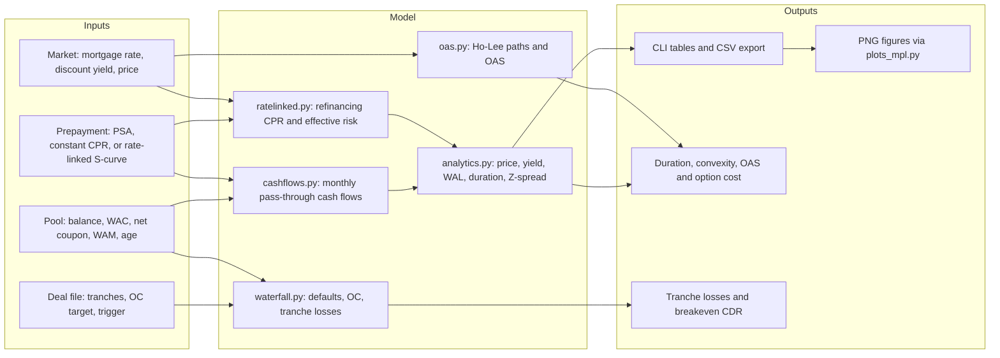
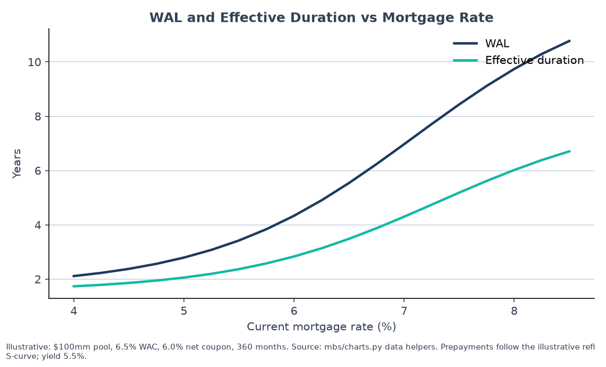
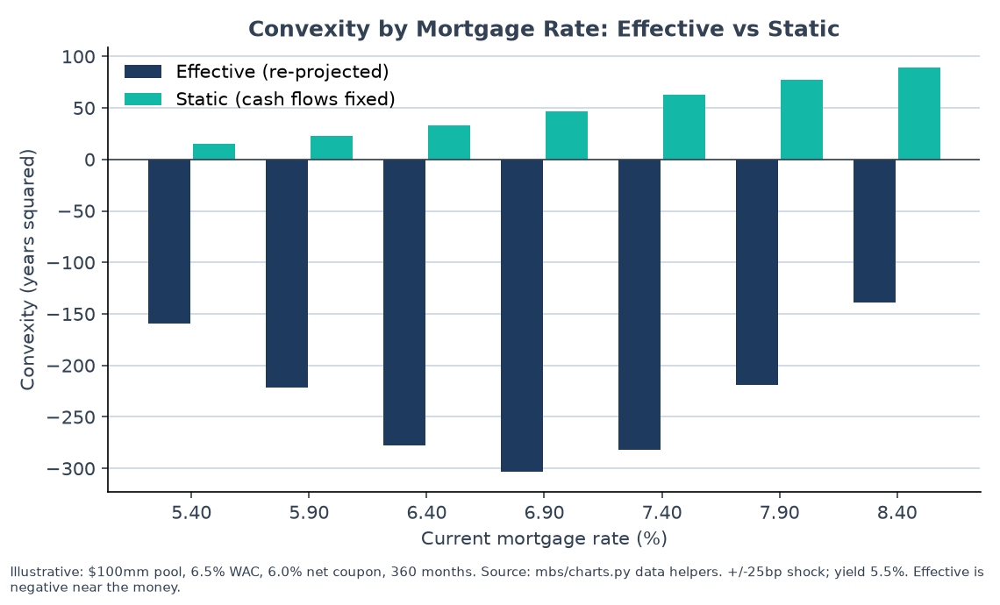
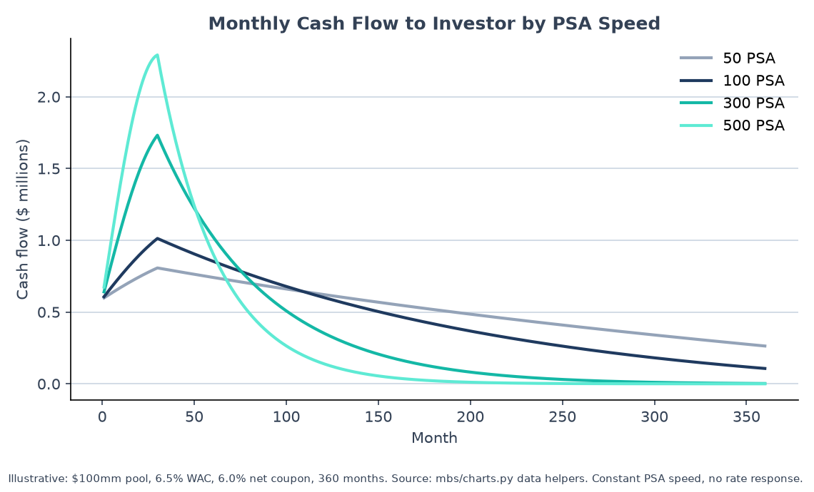
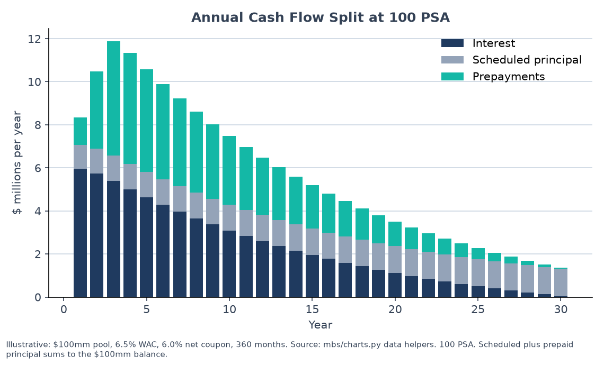
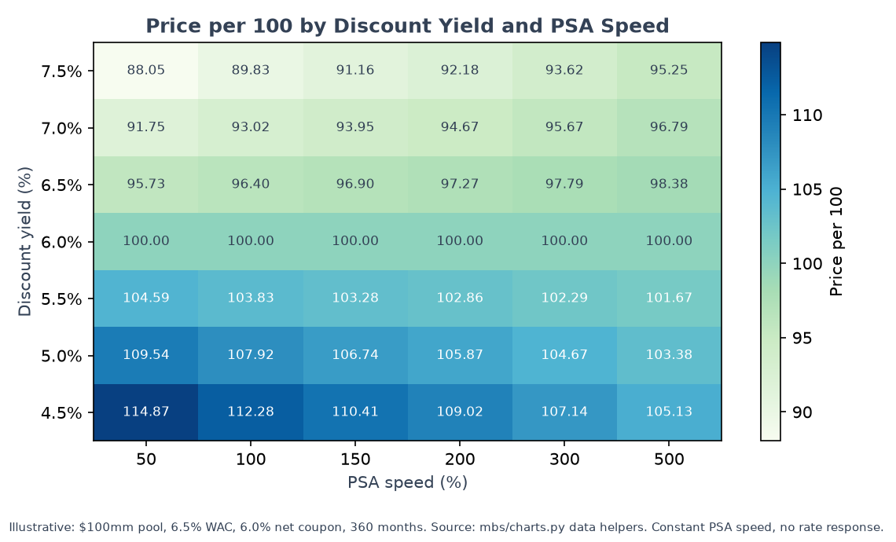

# MBS Cash Flow Model: full reference

The short project overview is in the [README](../README.md). This page keeps the full detail: concepts and formulas, architecture, the worked example, methodology and validation.

A dependency-free Python engine for agency mortgage pass-through securities (the bonds behind Fannie Mae, Freddie Mac and Ginnie Mae mortgages). It projects monthly cash flows, prices the bond, solves for yield and spread, measures how sensitive price is to rates and prepayments, and runs a simple tranche waterfall with defaults.

## 1. Executive summary

A mortgage bond is not a fixed-maturity bond. Homeowners can refinance or move, so the bond pays back principal early, and it pays back the most when rates fall, which is exactly when an investor would like the bond to keep paying the higher coupon. This model projects the monthly cash flows under a chosen prepayment assumption, then measures the price, the yield and the risk, including the "negative convexity" that comes from that early repayment. It also prices the prepayment option with a short-rate Monte Carlo (option-adjusted spread, OAS) and runs a senior/subordinate deal with losses. The core uses only the Python standard library, the key formulas are checked against published SIFMA examples, and every example number in this README is illustrative, not market data.

## 2. Key concepts

**Pass-through security.** A pool of mortgages is bundled, and investors receive the principal and interest the borrowers pay, minus a servicing and guarantee fee. The gap between the borrower rate (WAC, weighted average coupon) and the investor rate (net coupon) is the servicing strip.
`Interest_t = Balance_t x net coupon / 12`

**Prepayment speed.** A prepayment is an early payoff of principal. CPR (conditional prepayment rate) is the share of the balance that prepays over a year. SMM (single monthly mortality) is the same thing for one month. PSA is the industry benchmark ramp that starts at 0.2% CPR per month of loan age and reaches 6% CPR at month 30.
`SMM = 1 - (1 - CPR)^(1/12)` and `CPR(age) = 6% x min(age, 30) / 30` at 100 PSA

**Yield, price and duration.** Yield is the discount rate that makes the present value of the cash flows equal the price. Modified duration is the approximate percentage change in price for a 1% move in yield, so a duration of 5.8 means roughly a 5.8% price move per 1% yield move.
`P = 100 x sum(CF_t x (1 + y/12)^-t) / Balance` and `D_mod = Macaulay / (1 + y/12)`

**Convexity and negative convexity.** Convexity measures how duration changes as yields move. Normal bonds have positive convexity, which helps the holder. A mortgage bond near the money has negative convexity: when rates fall, prepayments speed up and cap the price gain, and when rates rise, prepayments slow down and extend the bond. Effective convexity re-projects the cash flows at each shocked rate, so it shows this effect; static convexity holds the cash flows fixed and misses it.
`C_eff = (P- + P+ - 2 P0) / (P0 x dy^2)` with the prepayments re-projected at each shocked rate

**Weighted average life (WAL).** WAL is the average time until each dollar of principal comes back, in years. It is the cleanest single number for how long the bond lasts under a prepayment assumption.
`WAL = sum((t/12) x Principal_t) / sum(Principal_t)`

**Z-spread and OAS.** The Z-spread is the constant extra yield over the risk-free curve that matches the price, holding cash flows fixed. The option-adjusted spread (OAS) does the same thing but averages over many simulated interest-rate paths, where prepayments respond to rates. The difference is the option cost: the spread the investor gives up to the borrowers' prepayment option.
`Option cost = Z-spread - OAS`

**Tranche waterfall.** A deal splits the pool into senior and junior classes. Cash comes in from interest and principal, is used first to pay interest, then to pay down the notes so that the collateral stays above a target overcollateralization (OC). Losses from defaults hit the most junior class first. A trigger switches principal to pay the senior class first if losses get too high.
`Needed = Notes - max(0, Collateral - OC target)`

**Breakeven CDR.** CDR (constant default rate) is the annual default rate. The breakeven CDR is the lowest default rate at which a given class first takes a loss. It is found by bisection, which means repeatedly halving the search range until the answer is pinned down.

## 3. Architecture



Files: `mbs/prepay.py` (CPR, SMM, PSA), `mbs/cashflows.py` (pool projection), `mbs/analytics.py` (price, yield, duration, spreads), `mbs/ratelinked.py` (refinancing S-curve), `mbs/oas.py` (Monte Carlo OAS), `mbs/waterfall.py` (deal waterfall), `cli.py` (command line), `plots_mpl.py` (figures).

## 4. Worked example (illustrative)

Inputs, all illustrative: a new $100mm pool with a 6.50% WAC, a 6.00% net coupon and 360 months remaining. The current mortgage rate is 7.40%, and the bond is discounted at 5.50%.

**Step 1: refinancing incentive.** The borrowers' rate minus today's rate is 6.50% - 7.40% = -0.90%. The pool is out of the money, so there is no refinancing wave.

**Step 2: rate-linked CPR.** `CPR = 4% + 41% / (1 + exp(-100 x (-0.009 - 0.01)))` = 9.33%.

**Step 3: monthly prepayment rate.** `SMM = 1 - (1 - 0.0933)^(1/12)` = 0.8133% per month.

**Step 4: month 1 cash flow.**

| Item | Calculation | Amount ($) |
|---|---|---|
| Gross interest on the WAC | 100,000,000 x 6.50% / 12 | 541,667 |
| Level payment on the WAC | balance x r / (1 - (1 + r)^-360), r = 6.50% / 12 | 632,068 |
| Scheduled principal | 632,068 - 541,667 | 90,401 |
| Interest to investor | 100,000,000 x 6.00% / 12 | 500,000 |
| Prepayment | 0.8133% x (100,000,000 - 90,401) | 812,545 |
| Total cash to investor | 500,000 + 90,401 + 812,545 | 1,402,947 |
| Ending balance | 100,000,000 - 90,401 - 812,545 | 99,097,053 |

**Step 5: outputs from `python3 cli.py --market-rate 7.40 --yield 5.5 --oas`.**

| Measure | Illustrative value |
|---|---|
| Price | 102.905 |
| Yield (monthly compounding) and BEY | 5.500% and 5.563% |
| WAL | 8.15 years |
| Modified duration (static) | 5.80 |
| Effective duration (prepayments re-projected, +/-25bp) | 5.01 |
| Static convexity | 62.4 |
| Effective convexity | -282.1 |
| Z-spread | 71.9bp |
| OAS (500 antithetic paths, 100bp vol, illustrative curve) | -3.8bp |
| Option cost (Z-spread minus OAS) | 75.6bp |

**Interpretation.** The bond trades at a premium, so falling rates would speed prepayments and shorten its life, which is why the effective duration (5.01) is shorter than the static duration (5.80) and the effective convexity is strongly negative. The option cost of about 76bp is the price of that prepayment option, and it leaves the OAS slightly negative, which means that after pricing the option the bond pays less than the illustrative curve, so it looks rich.

## 5. Visuals

All figures are illustrative and use the same $100mm, 6.50% WAC, 6.00% net coupon pool. Each PNG has its own source note. Regenerate them with `python3 reproduce.py`.



*Effective duration and WAL shorten as the mortgage rate falls and prepayments speed up. Illustrative; yield 5.5%.*



*Effective convexity is negative near the money, while static convexity (cash flows held fixed) stays positive. This gap is the prepayment option. Illustrative.*



*Faster prepayment speeds front-load cash and end the bond sooner. Illustrative; constant PSA speed.*



*Interest falls as principal comes back, and in the early years prepayments are larger than scheduled principal. Illustrative.*



*Price rises as yield falls and as prepayment speed slows for a premium bond. Illustrative; constant PSA speed.*

## 6. Methodology and assumptions

Every simplification below is deliberate and is documented in the code.

- **Prepayments.** PSA and constant CPR are inputs. The rate-linked mode uses an S-curve `CPR = 4% + 41% / (1 + exp(-100 x (incentive - 1%)))` whose parameters are illustrative, not fitted to agency data. The rate-linked CPR is constant over the life of the pool, with no seasoning.
- **Burnout.** An optional multiplier `exp(-k x cumulative prepaid fraction)` slows prepayments as the pool shrinks. This is a stylised form, not a published model. It is off by default.
- **Pricing convention.** Yield compounds monthly, the price is clean (no accrued interest), and settlement is assumed at the start of month 1. Real agency trades settle with a delay (for example, 14 days for Ginnie Mae I), which is only applied in the bond-equivalent (SIFMA G.1) functions.
- **OAS model.** A single-factor Ho-Lee short rate with absolute (normal) volatility of 100bp per year and no mean reversion. The curve is an illustrative 4% rising toward 5%, not market data. The mortgage rate is a 10-year zero rate plus a constant spread. Paths are antithetic and seeded, and each month's discount factors are scaled so the average reprices the curve exactly. Production desks use calibrated Hull-White or LIBOR-market-style models.
- **Collateral and losses.** Defaults are a constant default rate on the balance, not delinquency buckets. Defaulted loans pay no interest or principal, and they liquidate after a lag, with loss equal to severity times the defaulted amount. There are no servicer advances.
- **Waterfall.** Interest shortfalls are shared pro rata and are not carried forward. Overcollateralization and excess spread work as described above, and reserve accounts are not modelled. Class yields use the cash flows actually paid.
- **Scope.** A single-WAC pool, not loan-level data. The core is written for Python 3.9 or later and was tested on Python 3.13. The TOML deal loader needs Python 3.11 or later.
- **Units.** Convexity is in years squared, so values like -282 are large numbers by design.

## 7. Validation

- **Published references.** `tests/test_reference.py` checks the PSA ramp, SMM conversion and the SIFMA Standard Formulas worked examples: the first-month cash flow components (B.1), the prepayment speed example at month 17 of the PSA ramp (B.2), and the 14-day-delay average life, price, yield, duration and convexity (G.1).
- **Independent recalculation.** The month 1 table in section 4 was re-derived in a separate calculation straight from the formulas (not the projection loop), and it matches the program output to the dollar.
- **Internal consistency.** Zero-volatility OAS equals the Z-spread when prepayments do not depend on rates (`tests/test_oas.py`). The Z-spread round-trips to the input price. Waterfall cash is conserved in every period, junior classes take losses first, and breakeven CDR and loss grids are monotone (`tests/test_waterfall.py`).
- **Command.** `python3 -m unittest discover -s tests -t .` runs the suite on the standard library (Python 3.13 here). One chart test is skipped unless matplotlib is installed.

## 8. Quick start

```bash
git clone https://github.com/builtby-hari/RatesMortgageRiskLab.git && cd RatesMortgageRiskLab/mbs-cashflow
pip install -r requirements-extra.txt   # one-time: matplotlib, only for the PNG figures
python3 reproduce.py                    # reproduces the worked example and regenerates docs/figures/
```

The core model needs no install; `python3 cli.py --market-rate 7.40 --yield 5.5 --oas` prints the worked example on its own. Add `--waterfall sample_deal.toml --grid` for the tranche waterfall.
