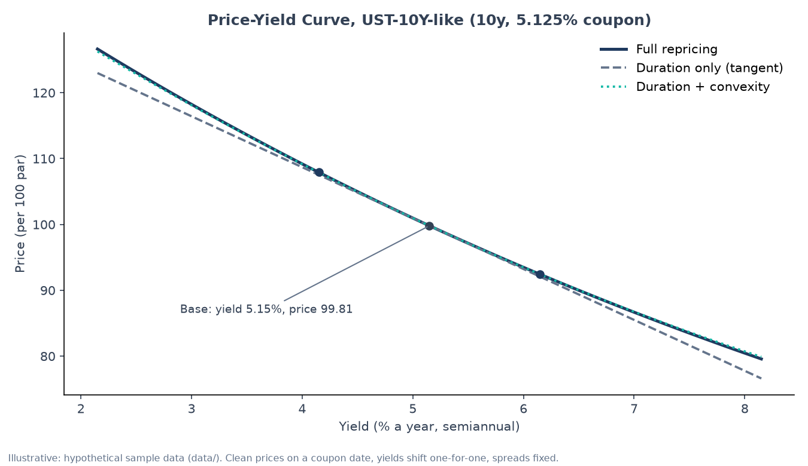
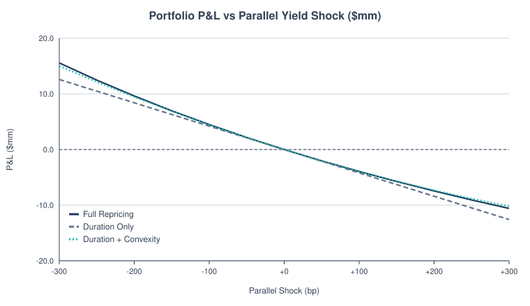
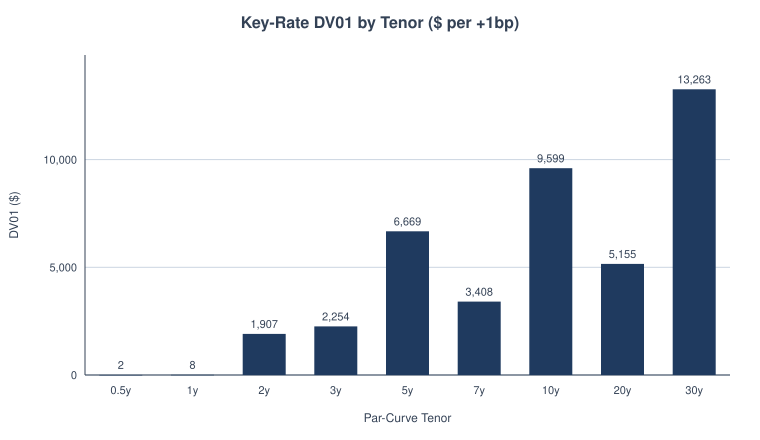
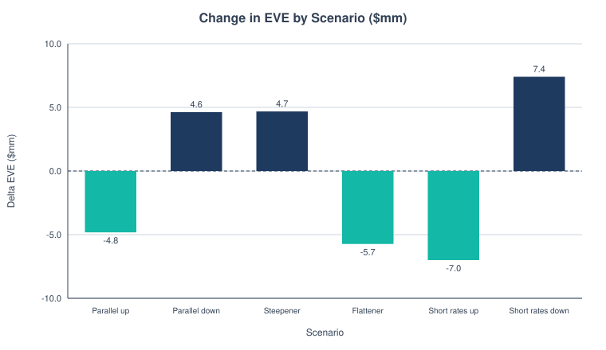
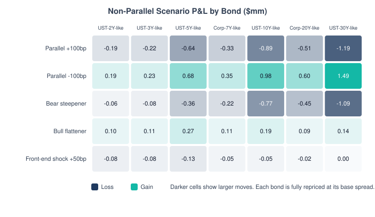
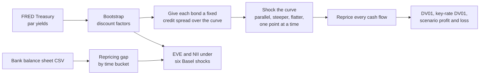

# Bond Rate Shock Analyzer

How much does a bond portfolio, or a bank's whole balance sheet, lose when rates move? This builds a Treasury curve from public Federal Reserve (FRED) yields, reprices every cash flow under different rate moves, and runs the six standard Basel rate shocks on a sample bank.

On a sample 10-year bond, the usual shortcut (duration alone) overstates a +100 bp loss by **4.8%**. Adding convexity gets within **0.16%** of the true repriced number.



## The result (illustrative bond and bank)

- A 10-year Treasury-style bond, $12mm par, loses **$885,433 (−7.39%)** on a +100 bp move when fully repriced.
- Duration alone says −$927,664, overstating the loss by **4.8%**. Adding convexity gets within **0.16%**.
- Sample bank: the worst of the six Basel shocks is **short rates up**, cutting the economic value of equity (EVE) by **$7.0mm**, 7.8% of Tier 1. That is inside the 15% outlier screen. The same shock cuts 12-month net interest income by 2.4%.

## The terms

- **bp (basis point):** 0.01%. A +100 bp shock is rates up 1 point.
- **Duration:** the percent a bond's price falls when rates rise 1 point. A straight-line estimate.
- **Convexity:** the curve in that line. It's why duration alone is too pessimistic when rates rise and too stingy when they fall.
- **DV01:** dollars lost when rates rise 1 bp. **Key-rate DV01** splits that by maturity, so you can see where on the curve the risk sits.
- **Full repricing:** discounting every cash flow again at the new rates. Slower, but exact.
- **EVE (economic value of equity):** the present value of a bank's assets minus its liabilities. **NII** is net interest income, what it earns on loans minus what it pays on deposits.
- **IRRBB:** Basel's rules for interest rate risk in the banking book. They define six shocks (rates up, down, steeper, flatter, short end up, short end down) and flag a bank that loses more than 15% of Tier 1 capital in any of them.

## More pictures

The same three estimates on the seven-bond sample portfolio. Duration alone (dashed) drifts away from full repricing as the shock gets bigger:

<picture>
  <source media="(prefers-color-scheme: dark)" srcset="docs/pnl_vs_shock-dark.svg">
  
</picture>

Where the risk sits on the curve. The portfolio loses $42,265 for each 1 bp rise in rates, and almost a third of that is at the 30-year point:

<picture>
  <source media="(prefers-color-scheme: dark)" srcset="docs/krd_by_tenor-dark.svg">
  
</picture>

The sample bank under the six Basel shocks:

<picture>
  <source media="(prefers-color-scheme: dark)" srcset="docs/eve_by_scenario-dark.svg">
  
</picture>

Not every move is parallel. Each bond under five curve scenarios:

<picture>
  <source media="(prefers-color-scheme: dark)" srcset="docs/scenario_heatmap-dark.svg">
  
</picture>

## Run it

```bash
python3 worked_example.py                                   # the bond example above, plus charts
python3 cli.py --curve --irrbb                              # portfolio with key-rate DV01 and Basel shocks
python3 cli.py --balance-sheet data/sample_balance_sheet.csv --tier1 90000000   # bank EVE and NII
python3 -m unittest discover                                # tests
```

The core uses only the standard library. `python3 -m bondshock.charts` redraws the SVG charts with no installs. The PNG charts need matplotlib.

## How it works



Bootstrapping turns quoted Treasury yields into a discount factor for each date, so any cash flow can be valued. The repricing gap lines up when the bank's assets and liabilities next reset their rates. A bank that funds long loans with short deposits gets squeezed when short rates rise.

## What I fixed along the way

- Bond-level `--irrbb` used the older Basel shock sizes. It now uses the 2024 calibration that is in force.
- The steepener and flattener now build on the absolute short and long shock sizes, as Basel's Annex 2 defines them.
- If Tier 1 looks like millions typed as dollars, the tool stops and asks instead of reporting a tiny percentage.

Full concepts, formulas and methods: [docs/reference.md](docs/reference.md).
