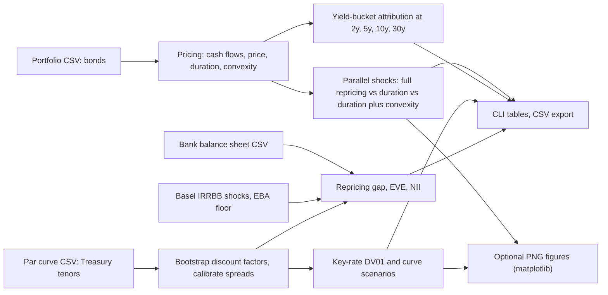
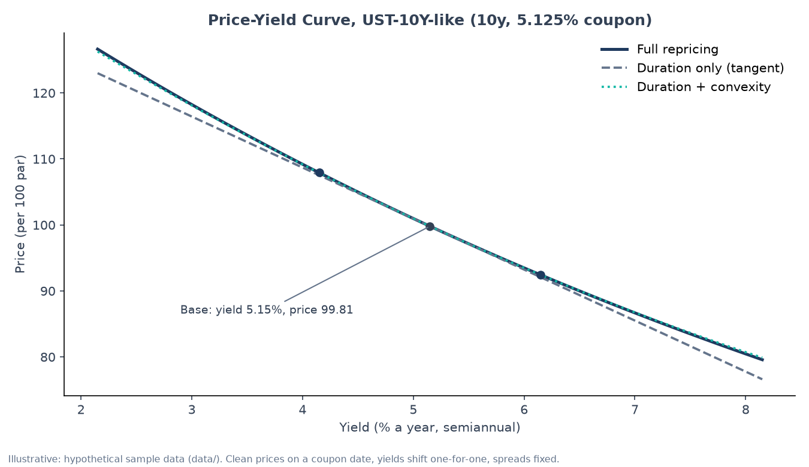
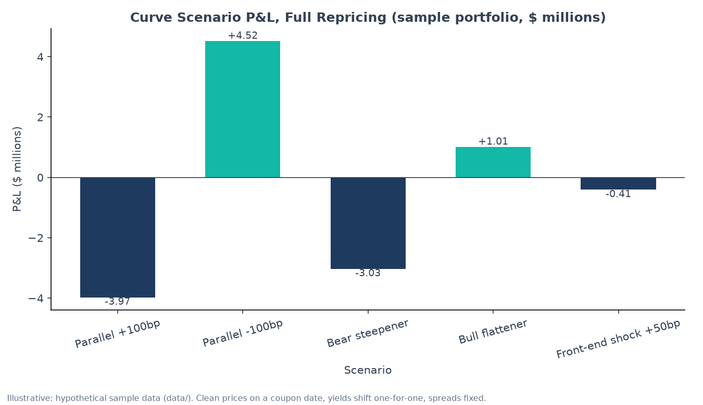
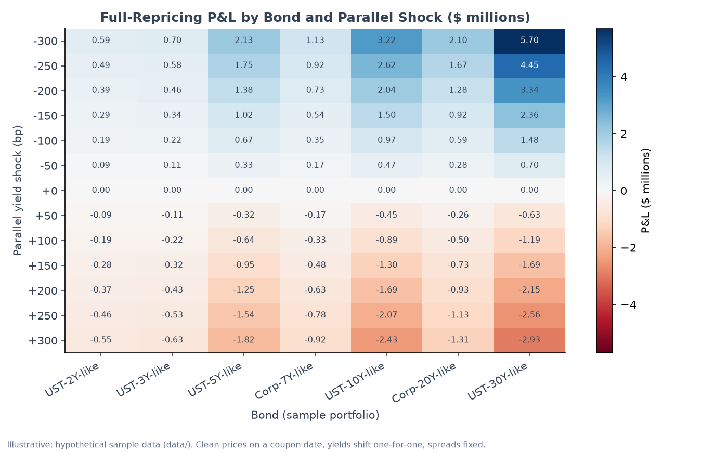

# Bond Rate Shock Analyzer: full reference

The short project overview is in the [README](../README.md). This page keeps the full detail: concepts and formulas, architecture, the worked example, methodology and validation.

A Python tool that measures how a bond portfolio's value moves when interest rates move, and how a bank's
economic value and interest income move under the Basel rate-shock scenarios. It uses only the standard
library for the core analysis. Every number in this README is **illustrative**, computed from the hypothetical
sample data in `data/`.

## 1. Executive Summary

Rates move, and a bond portfolio's market value moves with them, in the opposite direction. This tool answers
three questions for a fixed-rate bond book: how much value is lost (or gained) for a given move in rates, where
along the yield curve that risk sits, and how a bank's balance sheet fares under the regulator's standard
scenarios. It prices every cash flow off a bootstrapped Treasury curve rather than relying on a single duration
shortcut, so large moves are captured correctly. The output is a set of tables and charts that a treasury,
asset-liability or fixed-income risk team would recognize, with the simplifications stated up front.

## 2. Key Concepts

**Price and yield.** A bond's price is the present value of its coupons and principal, discounted at its yield
(the single rate that makes the discounted cash flows equal the price). Price and yield move in opposite
directions. Prices here are quoted per 100 of par (face value).

$$P = \sum_{k=1}^{n} \frac{CF_k}{(1 + y/f)^k}$$

**Modified duration.** The percentage price change for a 1 percentage-point move in yield, to first order. A
duration of 7.7 means roughly a 7.7% price drop for a 1% rise in yield. It is the Macaulay duration (the
time-weighted average of the cash-flow dates) divided by $(1 + y/f)$.

$$D = \frac{1}{P(1+y/f)} \sum_{k} \frac{k}{f} \cdot \frac{CF_k}{(1+y/f)^k}$$

**Convexity.** The curvature of the price-yield relationship. Duration assumes a straight line; convexity
captures the bend, so it matters for large moves. Convexity is always positive for a plain bond, so it cushions
losses on rate rises and adds gains on rate falls.

$$C = \frac{1}{P} \cdot \frac{d^2P}{dy^2} = \frac{1}{P f^2} \sum_k \frac{CF_k \, k(k+1)}{(1+y/f)^{k+2}}$$

**Duration and convexity estimate of P&L.** Combining the two gives the estimated market-value change for a yield
shock $\Delta y$. Full repricing is exact (up to the model); the estimate is the shortcut.

$$\Delta MV \approx MV \left(-D\,\Delta y + \tfrac{1}{2} C\,\Delta y^2\right)$$

**DV01 (dollar value of a basis point).** The dollar change in value for a 1bp (0.01%) rise in yield. A
portfolio with DV01 of $41,971 loses about $42,000 when yields rise 1bp. It is market value times duration, divided by 10,000.

**Key-rate DV01.** DV01 split by point on the curve (2y, 5y, 10y, 30y and so on). It answers where the risk
sits. Each tenor is bumped by 1bp on its own, with the rest of the curve held still, and the bond is fully
repriced. The bumps sum to the parallel DV01 only approximately, because curve shapes differ.

**Par curve, discount factors and zero rates.** The par curve gives the yield of a bond priced at par at each
tenor. Bootstrapping turns those par yields into discount factors $DF_k$ (the value today of $1 paid at
period $k$), one half-year at a time. Zero rates are the equivalent single-period rates.

$$DF_k = \frac{1 - (y_k/2)\sum_{j<k} DF_j}{1 + y_k/2}, \qquad z_k = 2\left(DF_k^{-1/k} - 1\right)$$

**Credit spread.** The extra yield a corporate bond pays over the Treasury curve. Each bond here carries a
constant spread, solved once so it reprices to its own yield, and held fixed while the curve moves.

**Curve scenarios.** Shifts to the whole curve that are not parallel, such as a *bear steepener* (long rates rise
more than short rates) or a *bull flattener* (long rates fall less than short rates). Each is applied and every bond is
fully repriced.

**IRRBB (interest rate risk in the banking book).** The risk that a bank's loans and deposits lose value or income
as rates move. The Basel Committee's framework (BCBS d368, recalibrated in BCBS d578 for 2026) sets six standard
shocks by currency: parallel up and down, steepener, flattener, and short rates up and down. The two metrics are:

- **EVE (economic value of equity):** the present value of assets less liabilities. The change in EVE under each
  shock is compared with 15% of Tier 1 capital (the supervisory "outlier" screen). Tier 1 is the bank's core capital.
- **NII (net interest income):** the 12-month change in interest income less expense under a shock.

**Repricing gap.** Assets less liabilities, grouped by the date each one resets to market rates. A positive gap
means the bank earns more when rates rise, to first order.

## 3. Architecture



The core is `bondshock/`: `pricing.py` (bond maths), `portfolio.py` (shocks and attribution), `curve.py` (curve,
key-rate DV01, scenarios, Basel shocks), `irrbb.py` (bank gap, EVE, NII) and `charts.py` (SVG output). `cli.py`
is the entry point. `worked_example.py` produces the figures in section 5.

## 4. Worked Example

Illustrative. Bond: **UST-10Y-like** from `data/sample_portfolio.csv` (a hypothetical 10-year Treasury-style bond).
Output of `python3 worked_example.py`, lightly trimmed:

- **Inputs:** par $12,000,000; coupon 5.125%; 10 years; 2 payments a year; yield 5.15%.
- **Cash flows:** each half-year pays 2.5625 per 100 of par, and 100 more at maturity (20 payments).
- **Discounting:** each cash flow is discounted at $1/(1 + 0.0515/2)^k$. The sum of the present values is
  the price, **99.8065 per 100**, so market value is **$11,976,781**.
- **Risk measures:** Macaulay duration 7.945 years; modified duration **7.746**; convexity **72.95** years squared.
- **Shock:** yield rises 100bp to 6.15%. Three estimates of the change in market value:

| Method | Estimated P&L on a +100bp shock | Error against full repricing |
|---|---:|---:|
| Full repricing (the reference) | -$885,433 (-7.39%) | 0 |
| Duration only (-D x MV x dy) | -$927,664 | -$42,231 (4.8% of the loss) |
| Duration + convexity | -$883,976 | +$1,457 (0.16% of the loss) |

**Interpretation:** duration alone overstates the loss on a 100bp rise by about 5%, and adding convexity brings
the estimate to within about 0.2% of full repricing.

## 5. Visuals

All three figures are illustrative and generated by `worked_example.py` from the sample data. Each one carries an
assumptions note at the bottom (hypothetical data, clean prices on a coupon date, yields shift one-for-one, spreads fixed).

**Figure 1. Price-yield curve with duration and convexity estimates.** Axes: yield in percent a year (semiannual
compounding) against price per 100 of par. The dashed line is the duration-only tangent; the dotted line adds
convexity. Points mark the base yield and the +/-100bp shocks.



**Figure 2. Curve scenario P&L, full repricing.** Axes: scenario against P&L in $ millions for the sample
portfolio of seven bonds ($65mm par). Bars are fully repriced after each curve move; spreads are held fixed.



**Figure 3. Full-repricing P&L by bond and parallel shock.** Axes: parallel yield shock in basis points (rows)
against each bond (columns); the colour and label give P&L in $ millions. The shock is applied to each bond's own yield.



## 6. Methodology and Assumptions

**Bond maths** (`bondshock/pricing.py`). Per bond, with $f$ coupons a year and $n = $ maturity $\times f$ periods:
prices, Macaulay and modified duration, and analytic convexity are the formulas in section 2. The yield is
nominal and compounded $f$ times a year. Maturities must be a whole number of coupon periods.

**Parallel shocks and attribution** (`bondshock/portfolio.py`). Three P&L estimates are reported for each shock
from -300bp to +300bp: full repricing, duration only, and duration plus convexity. The yield-bucket attribution
shocks each bond's yield by its key-rate weight (triangular weights on 2, 5, 10 and 30 years, summing to 1). It is
an approximation, and the residual is shown as an interaction term.

**Curve-based risk** (`bondshock/curve.py`). The par curve is linearly interpolated to half-years, bootstrapped
into discount factors, and each bond is priced as $\sum_k CF_k DF_k / (1 + s/2)^k$, where the constant spread $s$
is solved so the bond reprices exactly to its own yield. Key-rate DV01 uses +/-1bp triangular bumps with central
differences. Scenario shapes are piecewise-linear in tenor, with spreads fixed.

**Basel IRRBB** (`bondshock/curve.py`, `bondshock/irrbb.py`). The six shocks follow the Basel formulas. The 2024
recalibration table (`IRRBB_2024`) is the default, with `--currency` to change it. The EBA 2018 floor is optional
(`--floor`). EVE discounts on the bootstrapped par curve with no commercial margin. The outlier screen compares the
largest EVE loss with 15% of Tier 1.

**Bank balance-sheet conventions** (`bondshock/irrbb.py`). Fixed lines are bullets with semiannual coupons.
Floating lines carry the current rate and reset every `months`, and are worth their next coupon plus par at reset.
Non-maturity deposits split into a stable core (a bullet at `avg_life_years`) and an overnight remainder.
`beta` is the share of a shock passed to the deposit rate.

**Simplifications (the model's known limits):**

- No accrued interest, day-count convention or settlement lag. Prices are on coupon dates.
- No optionality: no calls, prepayment, early withdrawal or behavioural options. Mortgage-backed bonds would need an
  option model (OAS), which this tool does not have.
- Spreads are constant under curve moves, and are not re-estimated.
- The curve is flat beyond 30 years and maximum maturity is 60 years, semiannual bonds only in curve mode.
- Discount factors are linearly interpolated between half-years, not log-linear.
- **NMD valuation:** non-maturity deposits are valued at principal only. The interest they pay is ignored in EVE, so
  the base EVE level is not meaningful. Read the change in EVE, not its level.
- NII uses one instant shock per scenario, taken at the 0.5-year scenario value. It has no balance growth, no basis
  risk and no second-round deposit behaviour.
- The EBA floor is applied to par rates, not zero rates.
- NMD core share and average life are inputs. Regulatory caps (BCBS d368, paragraph 115) are not enforced.

**Data.** `data/treasury_par_curve.csv` holds a snapshot of Treasury par yields (2026-10-19), fetched from FRED
with `fetch_curve.py`. `data/sample_portfolio.csv` and `data/sample_balance_sheet.csv` are hypothetical and
exist only to exercise the code. Nothing here is investment, trading or balance-sheet advice.

## 7. Validation

**How the maths was checked.**

- Analytic modified duration and convexity are compared with central finite differences on every sample bond
  (`tests/test_bondshock.py`).
- The curve reprices par bonds to par, and the bootstrapped discount factors match closed forms on a flat curve
  (`tests/test_curve.py`).
- Key-rate weights sum to 1, and the key-rate DV01 sums agree with the portfolio-level figures to within the
  stated approximation.
- IRRBB scenarios are checked against the Basel formulas and an analytic flat-curve case, and the 2024
  calibration table is pinned by a test (`tests/test_irrbb.py`). The USD and EUR values were cross-checked against a
  secondary article. Bank EVE and NII are checked on hand-built balance sheets (`tests/test_bank_irrbb.py`).
- The worked example's modified duration and convexity match the finite-difference check. Its duration-only
  P&L is the arithmetic -D x MV x dy. The sample bank's NII parallel and steepener deltas were recomputed by hand
  from the balance sheet and match the CLI output.

**References.** Bond maths follows the standard definitions in Fabozzi, *Fixed Income Analysis* (duration and
convexity). IRRBB follows BCBS d368 (April 2016, Annex 2 shocks and paragraph 88 outlier test) and BCBS d578
(July 2024, recalibration in force from 2026-01-01). The 2024 USD values were cross-checked against a secondary
article; the primary d578 document has not yet been read line by line. Treat the IRRBB shock decay constant
(x = 4) as unconfirmed until it is checked against d368 Annex 2.

**Run the tests.**

```bash
python3 -m unittest discover -v
```

## 8. Quick Start

Install the optional extra (matplotlib, needed only for figures). The core runs on the standard library.

```bash
git clone https://github.com/builtby-hari/RatesMortgageRiskLab && cd RatesMortgageRiskLab/rate-shock
python3 -m pip install -r requirements-extra.txt
```

**One command** reproduces the worked example in section 4 and regenerates the figures in `docs/figures/`:

```bash
python3 worked_example.py
```

Other useful commands (standard library only):

```bash
python3 cli.py --curve                                  # sample portfolio with curve-based DV01 and scenarios
python3 cli.py --curve --irrbb --floor                  # add Basel IRRBB scenarios with the EBA floor
python3 cli.py --balance-sheet data/sample_balance_sheet.csv --tier1 90000000   # bank EVE and NII
```
